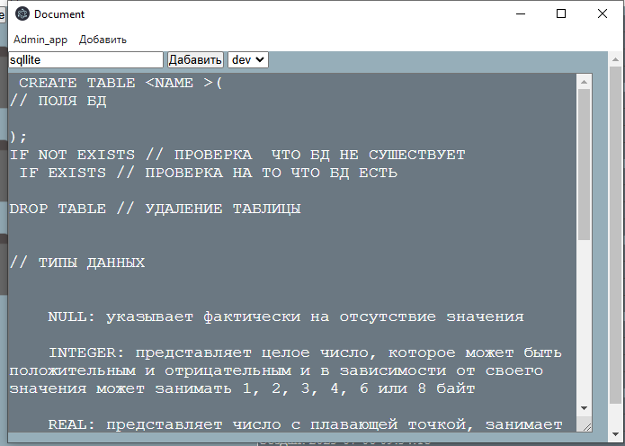
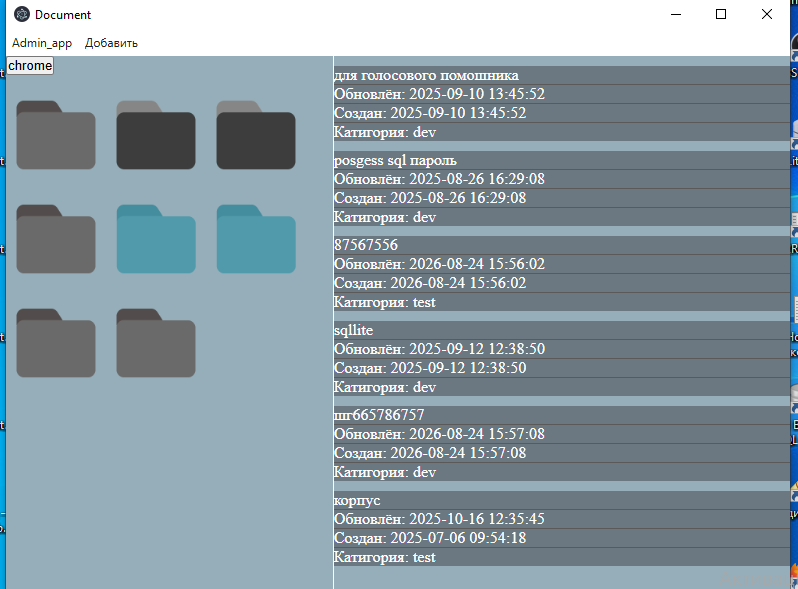
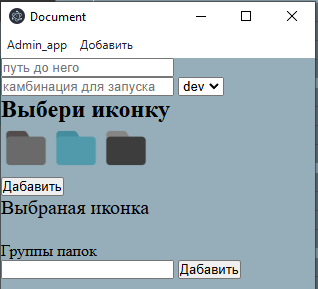
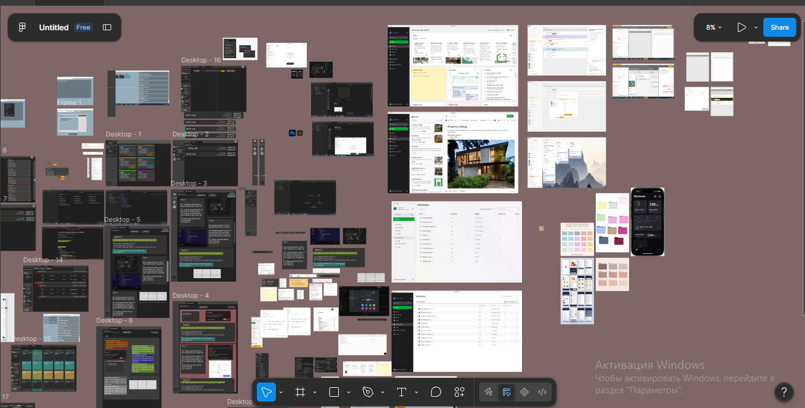
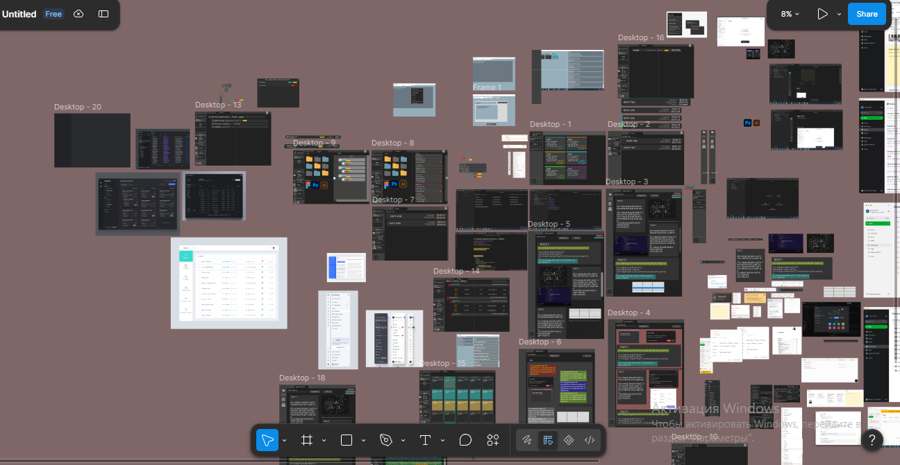
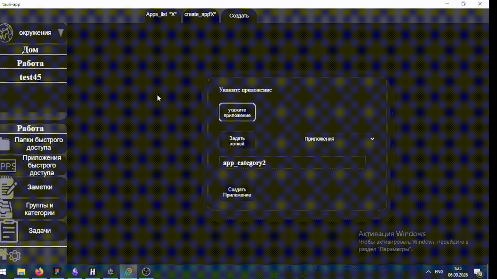

# UX UI Desigin (От «интерфейса 2010 года» к референсам)
## 1. Введение: Порядок разработки и дизайн прошлых версий

Предположим, после грамотного и полного сбора аналитики мы посчитали идею жизнеспособной и увидели возможность заработать.

Отступление: можно сначала сделать дизайн, а потом переходить к архитектуре данных, или наоборот — тут кому как удобнее.

Дизайн до текущей версии был спонтанным, о нём я вообще не думал:

> _«Ну, как-то выглядит, главное — чтобы работало»_.

По этой причине подробно останавливаться на прошлых итерациях не буду — там особо нечего рассказывать, оно «само так вышло».

  

## 2. Работа над интерфейсом v3: Поиск референсов

Перейдем к самому интересному — к разработке третьей версии (v3).

1. **Нарезка решений:** Сбор красивых элементов у существующих приложений в нише, чтобы сформировать визуальный ориентир.

2. **Поиск на Pinterest:** Предварительно запросил у LLM промпты:
    _«Вот моя идея. Как искать референсы и что именно гуглить?»_
        
3. **Сбор борда:** Какие-то элементы брал у LeaderTask, Obsidian и Evernote, что-то — прямо из Figma, а всплывающие окна срисовывал из готовых React UI-библиотек.
    
В итоге одна половина интерфейса родилась в Figma, а другая — создавалась прямо «на ходу».

### Референсы и экраны v3 из Figma:

   !
[Screenshot_14.png|697](./assets/Screenshot_14.png)

## 3. Эволюция UX: От ручной рутины к удобству

После общего плана перейдем к развитию UX (пользовательского опыта) в приложении.
### Добавление папок и приложений

- **В v3:** Вся процедура выполняется практически в один клик.
    
    
- **Раньше:** Приходилось вручную вбивать название и хоткеи (хорошо хоть путь сам подтягивался).
    ![[Pasted image 20260907141344.png|377]]
    
- **В самых первых версиях:** Абсолютно всё вбивалось руками, что было максимально неудобно.    
    ![[Pasted image 20260907141740.png]]
    
### Названия папок на экране

- **Самая первая версия:** Названий папок не было вообще, из-за чего использовать больше трёх папок было невозможно — иконок всего три (кстати, их я рисовал сам в Photoshop). Угадай сейчас, где какая:
    
    
    _Вот и думайте..._

- **Вторая версия:** На папках хотя бы появились названия.

    
    
    

> Это мелочи, но именно из таких мелочей складывается грамотный и понятный UI/UX дизайн.

## 4. Конкуренция UI/UX и фич: Почему пользователь уходит?

Для пользователя важны два ключевых фактора:
1. **Фичи приложения**.
2. **Понятный и приятный UI/UX**.    
Эти две позиции постоянно соревнуются между собой:

- Если нет нужных фич, пользователю незачем открывать приложение.
- Если фичи крутые, но UX/UI сделан непонятно или неграмотно, приложение быстро потеряет аудиторию.
 
**Правило 10–20 минут:** 90% пользователей принимают решение остаться с продуктом именно в первые 10–20 минут. Если человек скачал приложение, зашел, а там ни подсказок, ни плашек, ничего не понятно — он потыкает 5 минут, закроет его и вернется к привычным инструментам.

Все рынки заняты крупными игроками, и мы пытаемся зайти туда любыми путями. Если наш продукт проседает по удобству, мы теряем пользователя. Если продукт не заходит, маркетинг и SMM становятся выброшенными на ветер деньгами, и бизнес несет прямые убытки.

## 5. Что на самом деле волнует пользователя?

#### Пользователю абсолютно всё равно на:
1. Стек технологий, на котором написано приложение.
2. Архитектуру кода и баз данных.
3. Бюджет разработки и прибыль бизнеса.
#### Пользователя волнует только:
- Не лагает ли приложение?
- Понимаю ли я, куда тут нажимать?
- Нужно ли мне тратить время на обучение, чтобы просто начать пользоваться?
- Есть ли здесь нужные мне фичи?
- Как со мной общаются? Объясняют ли важные моменты?    
- Хвалят ли меня?
- Приятен ли интерфейс глазу?
## 6. Tone of Voice: Общение с пользователем и характер приложения

Важный UX-момент — то, **как** приложение разговаривает с пользователем. Грамотный язык общения не только делает интерфейс понятнее, но и формирует эмоциональную связь.

Пример: У пользователя 10 заметок без группы. Как сообщить об этом?
1. _Ничего не говорить:_ пусть будет хаос, как в Obsidian.
2. _Выдать сухую плашку «У вас 10 заметок без группы»:_ пользователь может не заметить, закрыть или подумать «и что?».
3. _Спамить уведомлениями:_ вызовет только раздражение.
4. _Мягко напомнить:_
    
    > _«Друг мой, у тебя 10 заметок не имеют группы — это порождает кашу и сложности в работе. Пожалуйста, разбери их во имя порядка и удобства!»_

5. _Более короткий вариант:_
    
    > _«Друг мой, у тебя 10 заметок не имеют группы, пожалуйста, разбери их во имя порядка и удобства»_.

Варианты 4 и 5 звучат проще, мягче и приятнее, чем сухое системное уведомление.

### Похвала как инструмент удержания

Пользователя стоит хвалить почти за всё подряд (например, за разбор мусора: _«Ты раскидал всё по группам, ты большой молодец!»_).

Жизнь — штука сложная, и приятные слова (особенно парням) делают не так часто. Окошко _«Ты умничка...»_ или обращение _«Друг мой...»_ реализовать несложно, но это сильно повышает коэффициент удержания (Retention). Мы добиваемся эффекта _«Меня хвалят, ура, я молодец!»_
формируя уникальный характер приложения, ради которого пользователь будет возвращаться снова и снова.