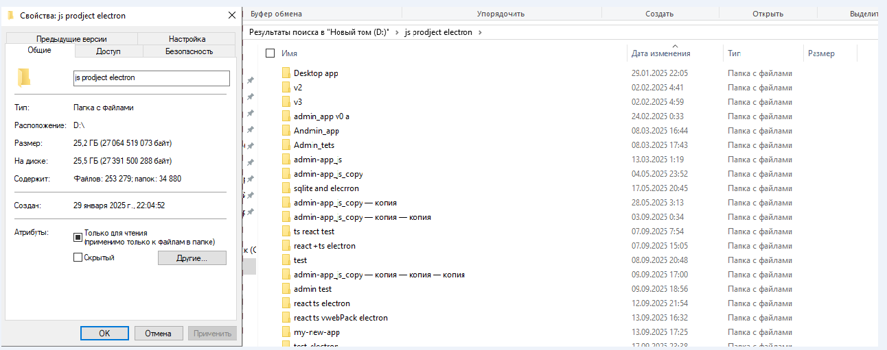

# Git & Git-Flow Process (Эволюция работы с версиями

## 1. Начальный этап (V1 и V2)

### V1

Git здесь нет вообще, ну не знал я, что это такое.

Здесь всё версионирование держалось на `проект копия копия`.

Здесь пол моей жизни (да, это классика).

Их много, не ясно, что где и когда, плюс вес всего вот этого 25 ГБ.

### V2

Git так же по сути нет (но здесь я впервые с ним познакомился).

В принципе, больше сказать-то и нечего.

## 2. Эволюция Git в V3

Предлагаю перейти к самому интересному — к V3.

Там много коммитов, поэтому я остановлюсь на самых основных и переломных моментах.

Итак, работа над проектом началась 8 февраля, и до 29 марта я забил на Git.

Потом сделал коммит как есть: `прогресс на 29.03.2026 18:59` — один огромный коммит.

Далее коммиты в основном хаотичны и беспорядочны до `02.06.2026 модалка работает как нужно`, там тоже "коммит-свалка".

НО здесь случилось прозрение: я понял, что так жить нельзя, и стал думать, как всё это улучшить.

Можно было взять Git-Flow (но он избыточен для работы в одного), поэтому я использую только фиче-ветки, но с доработкой.

## 3. Стандарт сообщения коммитов

|**Тип коммита**|**За что отвечает**|**Пример для Envalanher**|
|---|---|---|
|**`feat`**|Новая фича, кнопка, страница, логика бэка|`feat(app): create edit form layout`|
|**`fix`**|Исправление бага в логике или UI|`fix(tasks): fix subtask deletion toggle`|
|**`refactor`**|Улучшение кода, перенос в RTK, удаление дублей|`refactor(shared): extract menu state to RTK`|
|**`style`**|Правка опечаток, форматирование, отступы в CSS|`style(tasks): fix typo in context menu array`|
|**`chore`**|**Роуты, общие конфиги, инфраструктура**|`chore(router): define edit_app_page route`|

Еще стоило бы, помимо фиче-веток, сделать ветку для релиза.

Больше сказать-то и нечего.

## 4. Этапы эволюции VCS (Summary)

По сути, это всё можно разделить на три этапа:

1. **Начальный этап (Baseline)**
    
    - **Формат:** Свободный стиль коммитов (`editTask жив`, `03.04.2026`).
        
    - **Проблема:** Сложно отследить конкретные изменения и логику фичи при ревью.
        
2. **Внедрение Git Flow Lite**
    
    - **Изменения:** Переход на изолированные фиче-ветки (`feature/folder-manage`, `feature/notes-...`).
        
    - **Результат:** Защита основной ветки `develop` и изоляция нестабильного кода.
        
3. **Переход на Conventional Commits & Architecture Scope**
    
    - **Изменения:** Стандартизация сообщений по паттерну `type(scope): description`.
        
    - **Пример:** `feat(note > model): добавлен метод get_note_categories_by_id`.
        
    - **Результат:** История коммитов синхронизирована с архитектурными слоями (FSD / Backend models), что упрощает навигацию по изменениям.