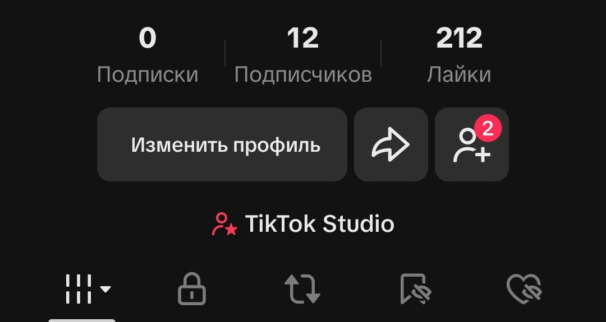

# Соло-разработка и выгорание

и так это страница больше про анализ пост размышления над  вопросами соло разработки и стабильности менталки и нервов
я считал что уже почти поймал золотую антилопу что еще буквально пару шагов и я ее поймаю
и всё 300-400 тысяч в месяц  свобода спокойствие  потом arduino станки и империя 
мне казалось что эти пол года буквально решают мою судьбу  
я особенно с майя по начало июля я работал по 12 часов 
писал сценарии для тик ток (об этом чуть позже   )
продумывал контент план 
снимал 
монтировал 
ражал фичи как не в себя 
думал над ui/ux 
пахал и пахал хлеше коня
я очень боялся что может и не получится (хоть и понимал что может ) но стойло кому-то из близких об этом сказать меня пробивало на слезы (минут 10-15 )

ну как вот так и прошлого время  с девизом  `мы работали, работаем  и будем работать `
до июля в 10-15 числах во мне что-то будто сломалось не могк нечего делать и всё 
оввыц лежал смотрел фильмы кушал спал (слава богу каникулы ) 
просто организм ушел в отказ 
в общем выгорание
 вот так в режиме овыщ недели три 
 потом гуляю и понимаю что проект та  мертв, таков он был изначально еще на этапе идеи 

самое интересное что после этого осознания у нечего не было
не печали, не грусти, не радости не смеха 
просто не-че-го просто 0 
вот так вот
и я до сих пор не отошел до конца  
больше то и нечего сказать

и теперь я пытаюсь хоть как-то эти проекты обернуть в + 

что касается тик ток 

### 🎬 Вторая работа: Эксперимент с TikTok и медиа-выгорание 

К безумному объему разработки я решил добавить маркетинг, думая, что продукт нужно продвигать прямо сейчас (это стоило начать делать с самого начала, идеи )
Я взял на себя полный цикл производства (аккаунт — вторая попытка, 6 видео, 212 лайков, 12 подписчиков)
- Писал сценарии и прорабатывал контент-план. 
- Отснимал рабочий стол, интерфейс и себя.
- Монтировал, обрабатывал видео и делал озвучку.
 

**Главный выгоревший урок:** я пытался «разгадать алгоритмы TikTok»   
на этапе, когда продукт был готов едва на 50%
Старт без предварительного «прогрева» и без показа самого процесса разработки с нуля (Build in Public) привел к тому, что огромная куча сил и времени ушла в никуда 
Попытка кодить по 12 часов и одновременно вести медиа-канал в одиночку просто сжёг меня изнутри

